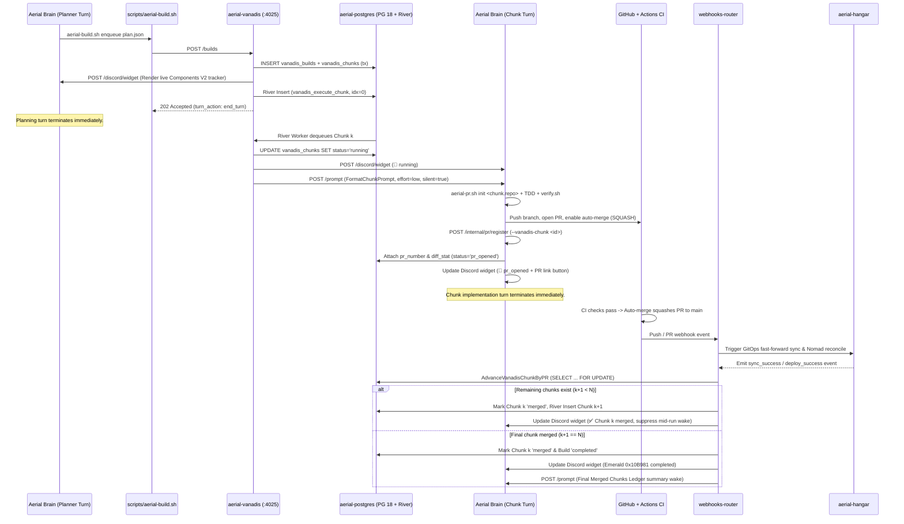

# 🛠️ Vanadis Autonomous Build Queue (`aerial-vanadis`)

**Vanadis** (`aerial-vanadis`) is Aerial's event-driven, multi-chunk build queue orchestrator. It decomposes large multi-step engineering plans (Tier 2 and Tier 3 features, cross-repository refactors, and multi-PR rollouts) into ordered, self-contained **~15-minute TDD chunks** (`1 chunk = 1 atomic PR`), executing each chunk in a fresh, isolated agent turn with zero CI polling.

---

## 🎯 Design Philosophy & Why Vanadis Exists

Executing a 5-PR feature inside a single monolithic LLM turn causes three structural failure modes:
1. **Quadratic Context Inflation**: Every file read, test run, and compiler trace accumulates in the session transcript, degrading reasoning quality and burning tokens quadratically across subsequent tool steps.
2. **Blocking CI Waits**: Waiting synchronously for GitHub Actions CI or container rollouts holds worker slots hostage and risks turn timeouts.
3. **Cross-PR Blast Radius**: Stuffing multiple architectural changes into one giant PR makes code review opaque and rollbacks painful.

Vanadis solves this by turning multi-PR execution into a **state machine backed by PostgreSQL 18 and River Queue**:
- **Zero-Polling Handoffs**: Every agent turn does strictly one thing—plan the build OR implement a single chunk—and terminates immediately upon enqueue or PR submission.
- **Fresh Context Per Chunk**: Each chunk runs in a clean turn (`effort: "low"`, `silent: true`) hydrated only with a compact ledger of prior merged chunks (`PR #` + `git diff --stat`) and explicit boundary guards for future chunks.
- **Multi-Repository Native**: Individual chunks within the same build can target different repositories (e.g., Chunk 1 in `azylman/aerial`, Chunk 2 in `azylman/aerial-config`), ordered deterministically via `chunk_index`.

---

## 🔄 End-to-End Event-Driven Lifecycle



---

## 🧠 Structured Chunk Prompt Contract

When `ExecuteChunkWorker` dequeues `ExecuteChunkArgs{BuildID, ChunkIndex}`, `FormatChunkPrompt` synthesizes a bounded, high-signal prompt for `aerial-brain`:

- **Build Header**: Build ID, active chunk repository, complexity tier, and overall build objective.
- **Completed Chunks Ledger**: Lists every preceding chunk (`0 .. k-1`) with its title, repository, merged `PR #`, and `git diff --stat` summary so the worker knows what already landed on `origin/main` without re-reading prior transcripts.
- **Active Chunk Specification**: Chunk ID, title, target repository, `target_files` list, and detailed TDD implementation instructions.
- **Remaining Chunks Boundary Guard**: Lists upcoming chunks (`k+1 .. N-1`) with an explicit directive: *"DO NOT implement these remaining chunks in this turn—they are listed strictly for architectural boundary awareness."*
- **Mandatory Execution Contract**:
  1. Initialize an isolated scratch clone off `origin/main` (`/share/aerial/scripts/aerial-pr.sh init <repo>`).
  2. Implement only the active chunk via TDD, verify with `./scripts/verify.sh --staged`, and author `PR_DESCRIPTION.md`.
  3. Submit asynchronously with `--vanadis-chunk <chunk_id>` and terminate the turn immediately.

---

## 🗄️ Persistence Schema & River Queue Architecture

Vanadis shares `aerial-postgres` (`PostgreSQL 18`) with `aerial-brain` and `webhooks-router` while operating its own dedicated River worker pool (`Queue: "vanadis"`, `MaxWorkers: 5`, `MaxAttempts: 3`, 15-minute unique deduplication window by `(build_id, chunk_index)`).

```sql
CREATE TABLE vanadis_builds (
    id TEXT PRIMARY KEY,
    repo TEXT NOT NULL,
    thread_id TEXT NOT NULL,
    tier INTEGER NOT NULL DEFAULT 2,
    objective TEXT NOT NULL,
    status TEXT NOT NULL DEFAULT 'running', -- running | completed | failed | cancelled
    status_message_id TEXT NOT NULL DEFAULT '',
    created_at TIMESTAMPTZ NOT NULL DEFAULT CURRENT_TIMESTAMP,
    updated_at TIMESTAMPTZ NOT NULL DEFAULT CURRENT_TIMESTAMP
);

CREATE TABLE vanadis_chunks (
    id TEXT PRIMARY KEY,
    build_id TEXT NOT NULL REFERENCES vanadis_builds(id) ON DELETE CASCADE,
    chunk_index INTEGER NOT NULL,
    repo TEXT NOT NULL DEFAULT 'azylman/aerial',
    title TEXT NOT NULL,
    instructions TEXT NOT NULL,
    target_files TEXT[] NOT NULL DEFAULT '{}',
    status TEXT NOT NULL DEFAULT 'pending', -- pending | running | pr_opened | deploying | merged | failed
    pr_number INTEGER,
    diff_stat TEXT NOT NULL DEFAULT '',
    created_at TIMESTAMPTZ NOT NULL DEFAULT CURRENT_TIMESTAMP,
    updated_at TIMESTAMPTZ NOT NULL DEFAULT CURRENT_TIMESTAMP,
    CONSTRAINT uq_vanadis_chunks_build_index UNIQUE (build_id, chunk_index)
);
```

---

## 🛡️ Failure Modes, Remediation & Wake Suppression

- **Mid-Run Deployment Wake Suppression (`ShouldSuppressVanadisDeployWake`)**: Normally, `webhooks-router` wakes Brain whenever a PR finishes deploying so the agent can confirm rollout. During an active Vanadis build, intermediate chunk deployments suppress `/prompt` wakes and silently update the Discord status widget instead, waking the agent only after the final chunk completes.
- **Proactive CI Failure Self-Healing**: If GitHub Actions CI fails on a chunk's PR, `webhooks-router` wakes Brain with the failing check logs. Brain checks out the PR branch, fixes the failure, and pushes directly to the PR branch; once CI turns green and merges, Vanadis automatically resumes chunk advancement.
- **Unmerged PR Closure & Retry Exhaustion**: If a chunk PR is closed without merging (`FailVanadisChunkByPR`) or `ExecuteChunkWorker` exhausts its 3 River attempts, both the chunk and parent build transition to `failed` (`❌`), halting subsequent chunks and surfacing a crimson alert banner on the Discord widget.
- **Live Discord Components V2 Widget**: Throughout the build lifecycle, a single Discord message (`status_message_id`) is edited in place with dynamic accent colors (purple `0xA855F7` while running, emerald `0x10B981` on completion, crimson `0xEF4444` on failure, amber `0xF59E0B` on cancel), per-chunk status badges (`⏳`, `🔨`, `👀`, `🚀`, `✅`, `❌`), diff stats, and direct PR link buttons. Builds exceeding 10 chunks automatically collapse older merged chunks to respect Discord's 40-component ceiling.

---

## 🔌 CLI & HTTP API Reference

Agents and operators interact with Vanadis via `scripts/aerial-build.sh` (routing to `http://vanadis.aerial` with fallback to `http://127.0.0.1:4025`):

- **`scripts/aerial-build.sh enqueue <plan.json>`** (`POST /builds` or `POST /runs`): Validates the build plan, auto-injects `DISCORD_THREAD_ID`, persists the build and chunks, posts the initial Discord tracker widget, enqueues Chunk 0, and emits `"turn_action": "end_turn"`.
- **`scripts/aerial-build.sh status <build_id>`** (`GET /builds/{id}`): Returns the parent `build` metadata and ordered `chunks` array.
- **`scripts/aerial-build.sh cancel <build_id>`** (`POST /builds/{id}/cancel`): Transitions an active build to `cancelled`, preventing any further chunk advancement, and updates the Discord widget to amber.
